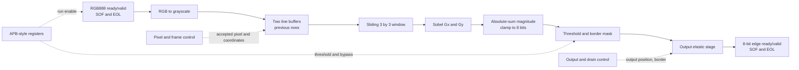
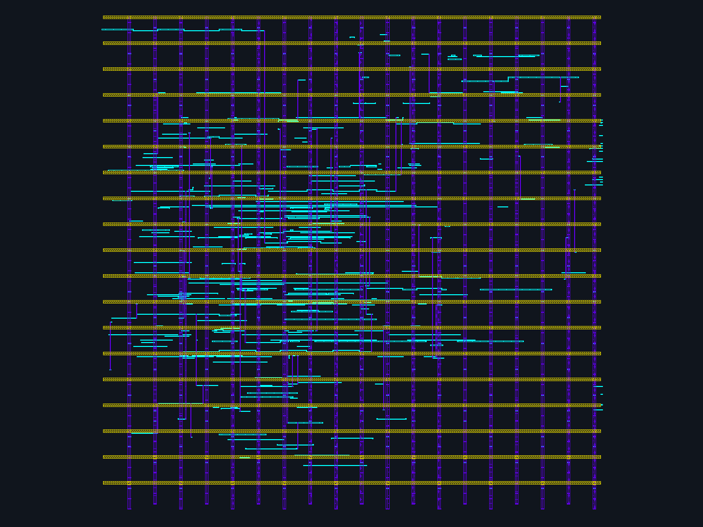
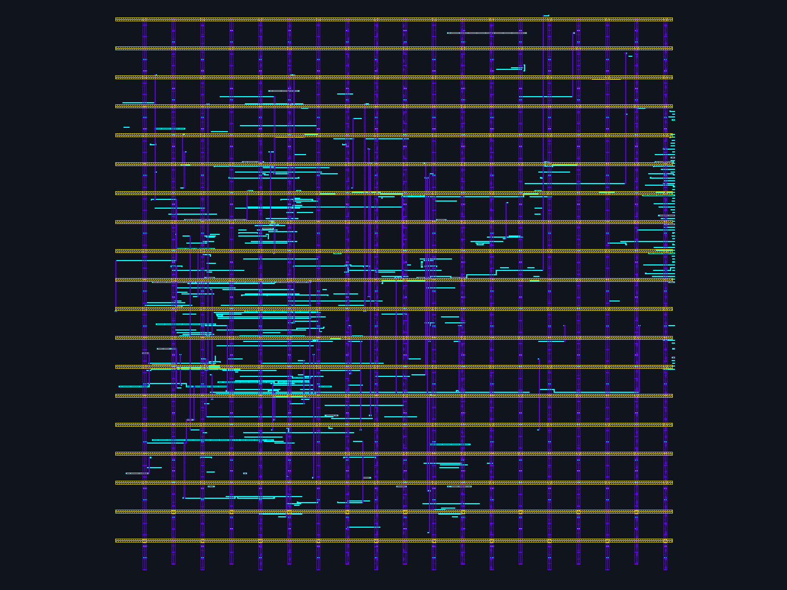
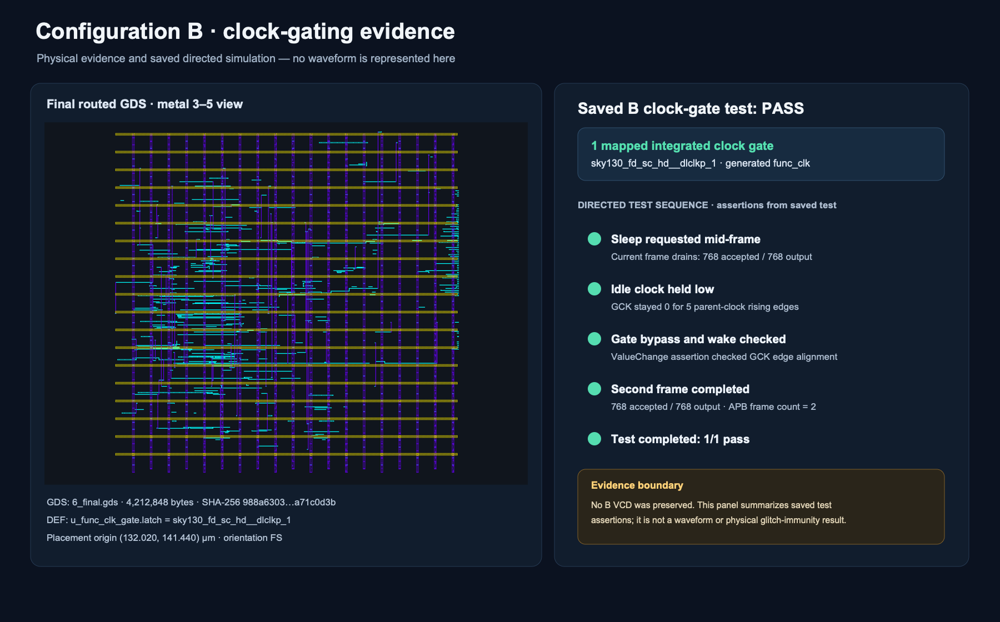
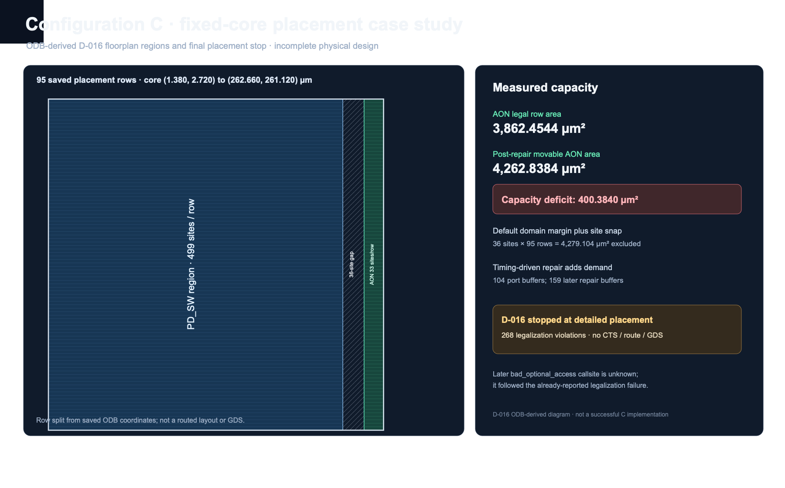

# Power-to-GDS

## Project overview

This repository documents a small ASIC study using the already verified Sobel streaming design from [from-rtl-to-pixels](https://github.com/dilanj123/from-rtl-to-pixels). The imported RTL is unchanged at commit `ad35514c990f6e1c9eb9fa18aee9d906f9df7721`; the ASIC top uses 32×24 images and the pinned ORFS/OpenROAD flow with SKY130HD.

The physical comparison is between A, which clocks the Sobel block directly, and B, which adds one mapped integrated clock gate. C explored a small PMU and UPF isolation boundary but failed physical placement. Portfolio scan configuration D was not run.

## Sobel pipeline and interfaces

The input is a 24-bit RGB ready/valid stream. `s_tuser` marks start of frame and `s_tlast` marks end of line. The imported datapath converts RGB to 8-bit grayscale with the weighted sum `(77R + 150G + 29B + 128) >> 8`, stores two prior rows, and forms a sliding 3×3 window. The Sobel block computes signed horizontal and vertical gradients. The output stage uses the L1 magnitude `|Gx| + |Gy|`, clamps it to 8 bits, applies the programmable threshold, and emits zero for border pixels. Elastic ready/valid stages preserve backpressure. The 8-bit output stream carries start-of-frame and end-of-line markers.

An APB-style register block controls run enable, threshold and bypass, reports processing/drain/error state, and counts completed frames. The principal RTL stages are `rgb_to_gray`, `line_buffer`, `window_3x3`, `sobel_compact`, `magnitude_clamp`, `threshold_stage`, `output_control`, and `apb_regs`.

The control blocks and datapath stages are in the imported top; the diagram summarizes those connections and does not imply additional hardware.

## A/B implementation difference

A instantiates the imported block under a thin parameter wrapper and uses the input clock directly. B keeps the same imported functional block and adds a small controller plus `sky130_fd_sc_hd__dlclkp_1`. Its controller remembers a sleep request during a frame, counts end-of-line transfers to detect the final input and output lines, waits for the frame and final output transfer to drain, then disables the functional clock. It re-enables the clock on wake and has a test-mode bypass. An `m_tlast` by itself is end-of-line, not end-of-frame.

## Routed layouts

These are views of the saved final routed GDS files, rendered with pinned KLayout at identical scale. **Only met3, met4 and met5 drawing layers are shown**; these are not all-layer views. Source artifact hashes and capture details are in [image provenance](images/README.md).

| A — conventional | B — clock-gated |
|---|---|
|  |  |

## A/B measured physical results

Both use the same imported functional source, 10.30 ns implementation target, and 12.00 ns mission evaluation. The mission result is read-only STA on each exact final ODB/SPEF at 12.00 ns. It is not the STA result at the implementation target.

| Metric | A: conventional | B: clock-gated |
|---|---:|---:|
| Final non-fill instances | 3,494 | 3,641 |
| Standard-cell area | 40,508.9 µm² | 41,745 µm² |
| Reported utilization | 60% | 62% |
| Mission WNS / TNS at 12.00 ns | +0.652646839619 / 0 ns | +1.492426633835 / 0 ns |
| Mission setup / hold violations | 0 / 0 | 0 / 0 |
| Mapped ICGs | 0 | 1 (`sky130_fd_sc_hd__dlclkp_1`) |
| CTS-created clock buffers | 71 | 77 |
| Detailed-route wire / vias | 71,488 µm / 19,639 | 73,342 µm / 20,721 |
| Detailed-route violations | 0 | 0 |
| Open-deck DRC / LVS | 0 report items / match | 0 report items / match |

The 10.30 ns implementation-target STA did not close: A reported WNS/TNS `−1.04735 / −10.1545 ns` with 18 setup violations; B also had negative WNS/TNS. A and B pass only at the separately reviewed 12.00 ns mission evaluation. Their physical results are outcomes of these runs, not a causal estimate of clock-gating overhead: the outer geometry and I/O constraints match, but A used the 50% core-utilization floorplan initializer while B used explicit geometry with `PLACE_DENSITY=0.60` and the same 0.25 lower-bound addon. See [detailed results](docs/RESULTS.md) for the resolved configuration distinction and complete reports.

## B clock-gating verification

The saved directed test requests sleep mid-frame, checks that the 768-pixel frame drains to 768 outputs, observes the gated clock held low across five parent-clock rising edges, then wakes and transfers a second frame. Assertions check gated-clock edge alignment in the simulation model, test-mode bypass, and the APB frame count. This is simulation evidence; it does not establish physical glitch immunity. No B VCD was retained.

## C PMU/UPF experiment

C added a PMU wrapper and `PD_AON`/`PD_SW` isolation intent around the unchanged Sobel block. An earlier inspected C floorplan checkpoint contained 37 isolation cells. Directed PMU tests and bounded 18-step SAT assertions passed; a separate 22-step SAT run emitted a sleep/wake trace. The bounded harness checks encoded PMU state-transition and control-order assertions. It does not prove the full streaming datapath quiescent or verify physical power switching.

The D-016 fixed-core attempt completed global placement but detailed placement reported 268 legalization violations. The saved AON placement region had 3,862.4544 µm² of legal row area against 4,262.8384 µm² of post-repair movable cell area, a 400.3840 µm² deficit. The default power-domain margin and site-grid snapping left a 36-site (16.56 µm) row gap; timing-driven buffering and resizing raised cell demand. A later `bad_optional_access` followed legalization failure, but the exact software callsite is unknown. C did not reach CTS, routing, extracted STA, GDS, DRC or LVS and is **not physically accepted**.

See the [C root-cause audit](results/processed/config-c-root-cause-audit.md) for checkpoint-level measurements and the limits of the diagnosis. The pinned SKY130HD platform has no valid physical power-switch master; the UPF switch is logical intent only.

## Source and repository navigation

- `rtl/imported/from-rtl-to-pixels-ad35514/` — immutable source modules, hash manifest and [provenance/copyright terms](rtl/imported/from-rtl-to-pixels-ad35514/PROVENANCE.md).
- `flow/phase1/config-a/` and `flow/phase1/config-b/` — conventional and clock-gated configurations and wrappers.
- `flow/phase1/config-c/` and `formal/phase1/config-c/` — PMU/UPF experiment and bounded formal harness.
- `constraints/` — A/B mission SDC files.
- `scripts/run_config_a_*` and `scripts/run_config_b_*` — simulation and ORFS entry points.
- `docs/RESULTS.md` — full A/B metrics and C findings; `docs/REPRODUCE.md` — commands and environment.
- `results/processed/` — concise processed evidence. Raw ODB/GDS/SPEF and tool logs are retained locally under ignored `results/raw/`, not in Git.

## Reproduction

Follow [docs/REPRODUCE.md](docs/REPRODUCE.md) for the immutable source identity, pinned tool/image and platform hashes, successful A/B simulation commands, and physical-flow runners. Closeout replayed A/B simulation and verified archived physical manifests, but did not freshly rerun the physical implementations. C recovery is closed and D was not run.

## Limitations

- The 10.30 ns implementation target is not timing-clean; A/B are accepted at 12.00 ns mission STA.
- Power reports are vectorless estimates with unannotated activity. No activity-based power reduction is demonstrated.
- Physical power switching is unavailable in the selected SKY130HD platform; C power-off is logical intent.
- C failed physical detailed placement; portfolio D scan was not run. A separate 12-flop smoke demonstrates limited scan-tool capability only.
- DRC/LVS use pinned open-source decks, not foundry sign-off. No fabrication or silicon measurement is claimed.
- The original complete A/B/C/D study remains incomplete. The reduced-scope disposition is CV-ready with limitations; see [known limitations](docs/KNOWN_LIMITATIONS.md).
