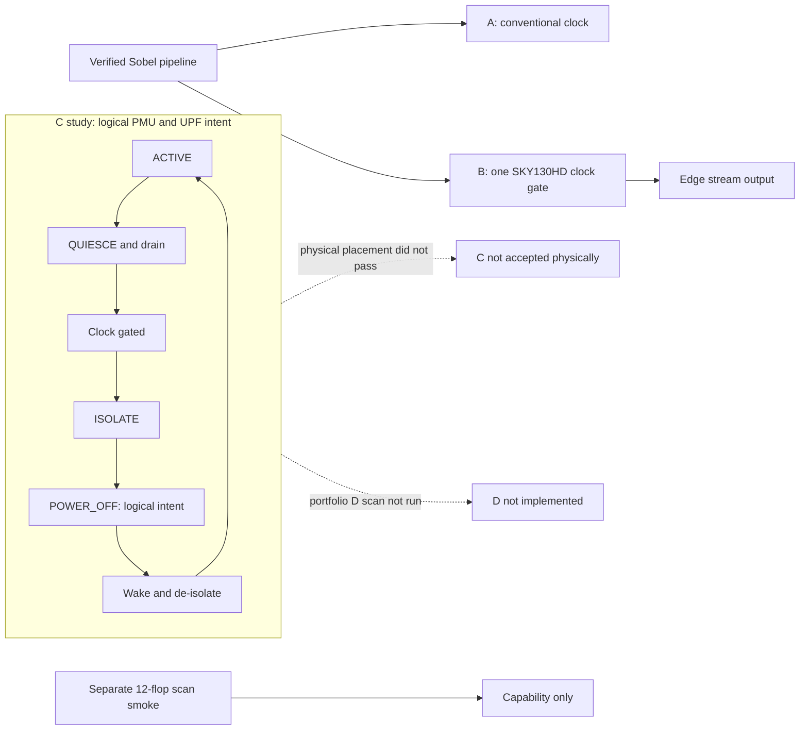

# Power-to-GDS

Power-to-GDS is a small RTL-to-GDS portfolio study using an already verified
Sobel image-processing pipeline. It compares a conventional implementation
with a clock-gated implementation, then documents what happened when the
project attempted a small PMU and UPF isolation partition.

## What was implemented

The functional RTL is imported unchanged from
[`from-rtl-to-pixels`](https://github.com/dilanj123/from-rtl-to-pixels) at
commit `ad35514c990f6e1c9eb9fa18aee9d906f9df7721`; the imported copy has a
provenance record documenting the source copyright terms. The ASIC study uses
32×24 images. The pinned ORFS/OpenROAD/Yosys flow targets SKY130HD.

- **A — conventional:** synthesized, placed, clock-tree synthesized, routed,
  extracted, and evaluated at a 12.00 ns mission period. GDS was generated;
  pinned open-deck DRC reported zero items and open-deck LVS matched.
- **B — clock-gated:** adds one mapped SKY130HD integrated clock gate. The
  same physical stages and open-deck finishing checks passed; the same mission
  STA acceptance passed.
- **C — PMU/isolation case study:** directed functional tests, bounded SAT
  checks, and UPF/isolation capability evidence passed. The fixed-core
  physical attempt ultimately failed detailed-placement legalization. C is
  not an accepted physical implementation.
- **Scan capability:** a separate 12-flop qualification smoke demonstrated
  scan replacement, chain stitching, pin placement, and routed scan wiring.
  Scan was not inserted into portfolio C/D.

## Main results

A and B both pass setup and hold at the reviewed 12.00 ns mission period.
B contains one mapped ICG. In this single implementation pair, B has higher
cell area, utilization, CTS buffer count, route wire length, and via count.
These are measured implementation differences; this pair alone does not
establish that clock gating caused every difference. Full values and earlier
timing failures are in [Results](docs/RESULTS.md).

The project does **not** claim completion of the original A/B/C/D scope:
portfolio C was not physically completed and portfolio D was not run. The
reduced portfolio scope and limitations are explicit. There is no physical
power-switch master in the pinned SKY130HD platform, no physical power-gating
claim, no measured power reduction, no ATPG/fault-coverage result, and no
foundry sign-off.

## Reproduction

See [Reproduction](docs/REPRODUCE.md) for source identity, pinned tool/image
details, fresh A/B simulation commands, and archived physical run commands.
Fresh A/B simulation replay passed during portfolio closeout. The A/B
physical databases were archive-hash checked; a clean physical replay was not
performed during closeout.
